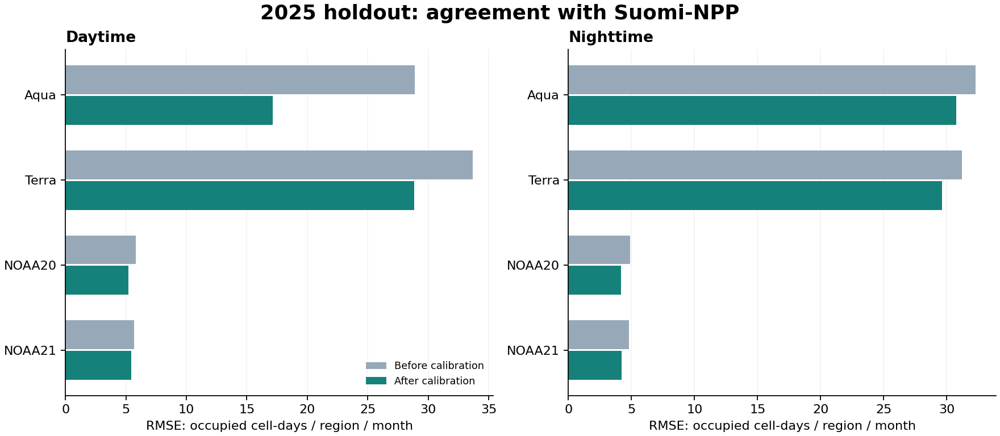

# Результаты проверки на ваших данных

Обработка выполнена 14 ноября 2026 года. Использованы все четыре исходных ZIP, не выборка. Исходные файлы не изменялись.

| Проверка | Результат |
|---|---|
| Входные строки | 15 656 817 |
| Точные дубликаты | 7 |
| Канонические детекции | 15 656 810 |
| Прошли правила confidence | 14 770 763 |
| Занятые спутник/ячейка/дата/DN/processing | 7 558 409 |
| Невалидные обязательные поля | 0 в этих файлах |
| Импорт четырёх ZIP | 289,4 с |
| Обучение модели | 4,52 с |
| Автотесты | 40 passed |

Время измерено в среде проверки с Python 3.12; скорость другой машины может отличаться. Полные исходные наблюдения сохраняются в базе, но в пакет включены код, небольшой реальный пример и отчёты, а не многогигабайтная БД.

## Отложенная проверка: 2025

Train: 2013–2024 внутри фактического пересечения платформ. Reference: SNPP; дневные и ночные модели отдельно. Метрики относятся к общей обучающей поддержке и зарегистрированной активности, не к числу реальных пожаров.

| Источник | D/N | Коэффициент | RMSE до | RMSE после | Bias после | Замечание |
|---|---|---:|---:|---:|---:|---|
| Aqua | D | 2.8344 | 28.896 | 17.136 | -10.5% | RMSE и MAE улучшились |
| Aqua | N | 13.9637 | 32.301 | 30.734 | -87.5% | большое остаточное смещение |
| NOAA20 | D | 0.9497 | 5.789 | 5.182 | 1.1% | RMSE и MAE улучшились |
| NOAA20 | N | 0.9363 | 4.874 | 4.173 | 2.4% | RMSE и MAE улучшились |
| NOAA21 | D | 0.9680 | 5.688 | 5.419 | -0.1% | только 2 года обучения |
| NOAA21 | N | 0.9226 | 4.803 | 4.196 | 0.2% | только 2 года обучения |
| Terra | D | 2.7700 | 33.702 | 28.860 | -20.8% | MAE ухудшился |
| Terra | N | 7.6616 | 31.213 | 29.625 | -77.8% | большое остаточное смещение |

Дневной Aqua: RMSE уменьшился примерно на **40,7%**, суммарное смещение — с −68,4% до −10,5%. Это полезная демонстрация baseline.

Ночной MODIS нельзя представлять как успешно гармонизированный ряд: после поправки остаётся смещение около −87,5% у Aqua и −77,8% у Terra. Простое масштабирование не восстанавливает отсутствующие обнаружения. Дневной Terra улучшил RMSE, но ухудшил MAE. NOAA-21 имеет только два года train, что ограничивает выводы.

## Календарь и сезонность

`china_calendar_2000_2025.json/csv` содержит 302 месяца, ноябрь 2000 — декабрь 2025, daytime, все hotspot types. Для демонстрации явно включена историческая экстраполяция. Единица — SNPP-equivalent occupied cell-days. Поддержка зафиксирована на пересечении **830 обучающих регионов 100 км** для Terra/Aqua. Данные вне поддержки обозначены полями excluded и flags.

`china_seasonality_2025.json` сравнивает 2025 с 2013–2024. В этом временном окне используется SNPP и вся доступная область, поэтому support отличается от ряда 2000–2025. Наиболее активные в среднем месяцы: **март, апрель, октябрь**. За 2025 год ни один месяц не вышел за описательный порог |z|≥2 относительно этой базы. Это не означает отсутствия локальных аномалий: агрегация по всей загруженной территории может их скрывать.

## Файлы проверки

- `input_audit.json` — строки, диапазоны, платформы и аудит каждого CSV.
- `china_calibration.json` — параметры, support, коэффициенты, bootstrap CI и метрики.
- `validation_metrics_2025.csv` — плоская таблица метрик.
- `china_calendar_2000_2025.json/csv` — экспериментальная история с происхождением и flags.
- `china_seasonality_2025.json`, `seasonal_profile.csv` — месячная база и аномалии.
- `http_smoke.json` — фактическая проверка Uvicorn по HTTP на реальном demo-фрагменте.
- `pytest_results.txt` — вывод автоматических тестов.

Сохранённые model_id в отчётах относятся к исходному запуску. На новой БД получите новый model_id из своего calibration job; одни JSON-отчёты не регистрируют модель в API.

Внешний live-запрос FIRMS не выполнялся: MAP_KEY пользователя отсутствует. Клиент проверен mock-ответами и готов к серверной настройке ключа. Docker отсутствовал в среде; Python/Uvicorn проверены, образ не собирался.
